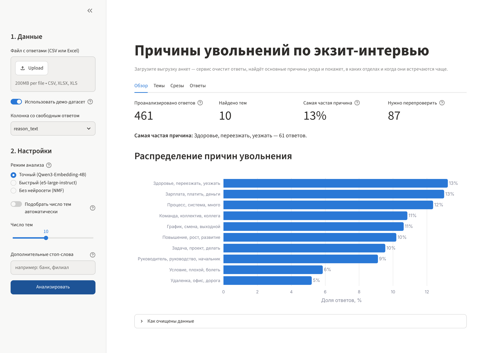

# Тематическое моделирование экзит-интервью

Веб-сервис для HR: загружаете CSV/Excel с ответами уволившихся сотрудников, сервис очищает текст,
выделяет темы (причины увольнения) и их ключевые слова и показывает распределение причин по отделам,
стажу и времени.

Учебный проект, направление 01.03.02 «Прикладная математика и информатика», ОП «Прикладное машинное обучение».

**Команда:** Капитанов Станислав, Паксяев Алексей, Бурлин Александр.

## Подход

Сравниваем два семейства методов на одном датасете с эталонными метками:

| | Классический | Нейросетевой |
|---|---|---|
| Представление текста | лемматизация → мешок слов / TF-IDF | эмбеддинги `Qwen3-Embedding-4B`, `multilingual-e5` и др. |
| Модель | LDA, NMF, GSDMM | кластеризация эмбеддингов: KMeans, UMAP + HDBSCAN (подход BERTopic) |
| Ключевые слова | веса слов в теме | c-TF-IDF по лемматизированному тексту |

Метрики: совпадение с эталонными метками (ARI, NMI, F1), связность и разнообразие тем, устойчивость.

**Результат:** лучшая модель — `Qwen3-Embedding-4B` с инструкцией «определи причину увольнения» + KMeans:
ARI 0.68, macro-F1 0.83, устойчивость 0.80 (у LDA — 0.02 / 0.17 / 0.02). Подробности — [docs/modeling.md](docs/modeling.md).

## Структура

```
data/
  synthetic_source/   исходные тексты по темам (сгенерированы LLM)
  raw/                собранный датасет: exit_interviews.csv/.xlsx, *_labeled.csv
  processed/          результаты предобработки
docs/                 документация (описание датасета и т.д.)
notebooks/            эксперименты и сравнение моделей
src/
  generation/         таксономия и генерация синтетического датасета
  preprocessing/      загрузка файлов, очистка, лемматизация, фильтр пустых ответов и дублей
  models/             LDA, NMF, GSDMM, модель на эмбеддингах (общий интерфейс)
  evaluation/         метрики качества
  app/                веб-сервис: логика анализа, графики, интерфейс на Streamlit
tests/
```

## Быстрый старт

```bash
python -m venv .venv
source .venv/bin/activate        # Windows: .venv\Scripts\activate
pip install torch --index-url https://download.pytorch.org/whl/cpu
pip install -r requirements.txt

# веб-сервис: http://localhost:8501
streamlit run src/app/streamlit_app.py

# пересобрать датасет из исходных текстов
python -m src.generation.build_dataset

# предобработка: отчёт, примеры «было → стало», результат в data/processed/
python -m src.preprocessing data/raw/exit_interviews.xlsx

# сколько даёт каждый шаг предобработки (метрики на эталонных метках)
python -m src.evaluation.preprocessing_report

# сравнение моделей и подбор числа тем (модели скачаются с Hugging Face, ~20 ГБ)
python -m src.evaluation.model_comparison

# видны ли в результатах сервиса закономерности, заложенные в датасет
python -m src.evaluation.patterns_check

# тесты
pytest
```



Использование в коде:

```python
from src.preprocessing import TextPreprocessor, load_table, preprocess_dataframe

df = load_table("data/raw/exit_interviews.xlsx")
clean, report = preprocess_dataframe(df, "reason_text")
print(report.as_text())

TextPreprocessor().tokens("Зп маленькая, обязанностей добавили!!! 😔")
# ['зарплата', 'маленький', 'обязанность', 'добавить']
```

## Документация

- [docs/dataset.md](docs/dataset.md) — датасет: поля, способ генерации, заложенные закономерности.
- [docs/preprocessing.md](docs/preprocessing.md) — предобработка: шаги, решения, результаты.
- [docs/modeling.md](docs/modeling.md) — модели, их сравнение и выбор.
- [docs/app.md](docs/app.md) — веб-сервис: запуск, возможности, проверка на закономерностях.
- [docs/deploy.md](docs/deploy.md) — публикация на Hugging Face Spaces и запуск через Docker.
- [notebooks/03_topic_modeling.ipynb](notebooks/03_topic_modeling.ipynb) — темы, которые находят модели (показ 3).
- [docs/evaluation.md](docs/evaluation.md) — как мы оцениваем качество и почему результатам можно верить.

## План по спринтам

| Спринт | Недели | Результат |
|---|---|---|
| 1. Данные | 1–3 | Синтетический датасет с метками, репозиторий, доска задач — **готово** |
| 2. Предобработка | 4–6 | `TextPreprocessor`: очистка, лемматизация, стоп-слова, тесты — **готово** |
| 3. Моделирование | 7–9 | LDA, NMF, GSDMM, 7 моделей эмбеддингов, подбор числа тем, сравнение метрик — **готово** |
| 4. Интерфейс | 10–12 | Streamlit: загрузка файла, темы, срезы, динамика, переименование тем, выгрузка — **готово** |
| 5. Стабилизация | 13–15 | Деплой, тесты на новых данных, документация, презентация |

## Правила работы с Git

- `main` — только рабочий код, изменения через pull request.
- Ветки: `feature/<что-делаем>`, `fix/<что-чиним>`.
- Сообщение коммита отвечает на вопрос «что изменилось»: `Добавить лемматизацию через pymorphy3`.
