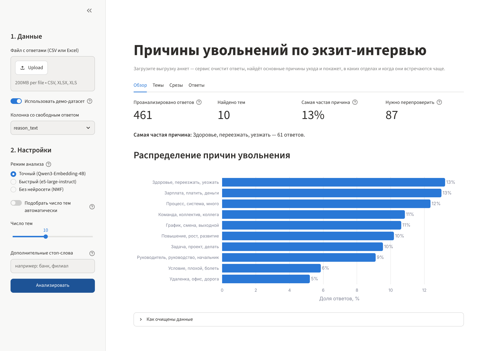
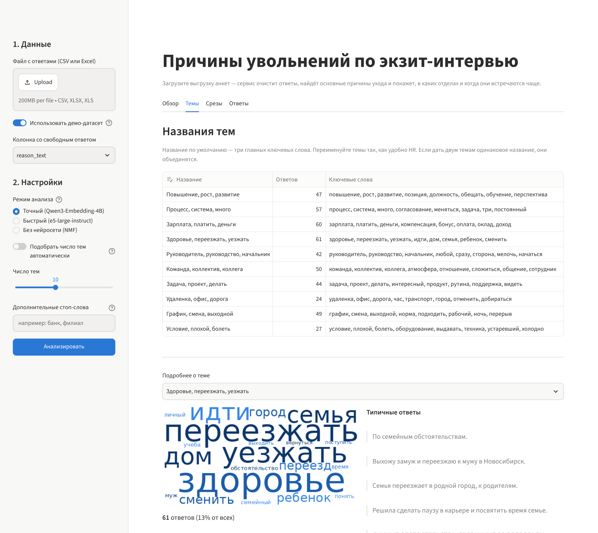
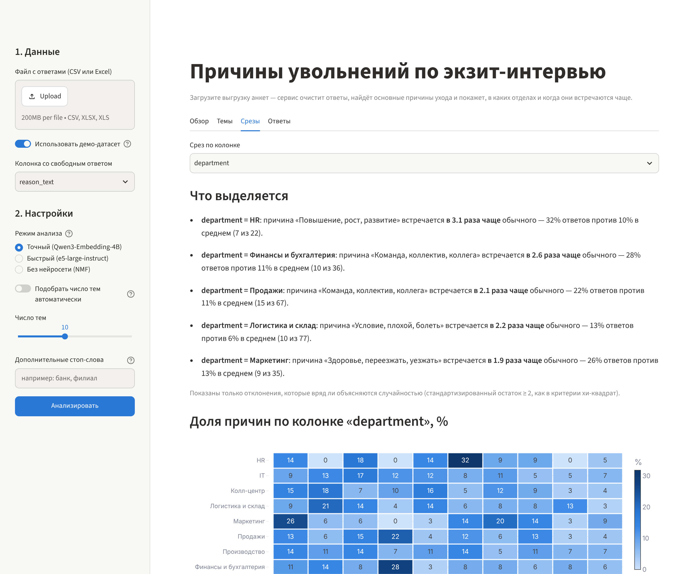

# Веб-сервис

Код: `src/app/` — `analysis.py` (вся логика, без интерфейса), `charts.py` (графики),
`streamlit_app.py` (интерфейс). Тесты: `tests/test_app_analysis.py`.

## Запуск

```bash
pip install torch --index-url https://download.pytorch.org/whl/cpu   # PyTorch для CPU
pip install -r requirements.txt
streamlit run src/app/streamlit_app.py
```

Откроется http://localhost:8501. При первом анализе в точном режиме скачивается модель
Qwen3-Embedding-4B (~8 ГБ), это занимает несколько минут. Дальше модель и эмбеддинги берутся из кэша.

Нужно свободной памяти: точный режим — ~10 ГБ, быстрый — ~3 ГБ, режим без нейросети — меньше 1 ГБ.

## Как пользоваться

1. **Данные.** Загрузите CSV или Excel либо включите демо-датасет. Колонка со свободным ответом
   определяется автоматически (самые длинные тексты), её можно поменять.
2. **Настройки.**
   - Режим: точный (Qwen3-Embedding-4B), быстрый (e5-large-instruct) или без нейросети (NMF).
   - Число тем: задать вручную (по умолчанию 10) или подобрать автоматически по силуэтному коэффициенту.
   - Дополнительные стоп-слова: например, название компании, если оно попадает в ключевые слова.
3. **Анализировать.** Результат появляется на четырёх вкладках.

### Обзор



Сколько ответов проанализировано, сколько тем найдено, самая частая причина и сколько ответов модель
отнесла к теме неуверенно (их стоит проверить вручную). График — доля каждой причины.

Уверенность — насколько ответ ближе к центру своей темы, чем к остальным (softmax по сходствам).
Сходства измеряются в единицах их типичного разброса, потому что у разных моделей он разный: у e5
почти все сходства лежат в узком диапазоне 0.80–0.90, у Qwen3 разброс вдесятеро больше. Без этой
поправки в быстром режиме все ответы помечались неуверенными. Метка работает: на размеченном
датасете среди уверенных ответов к правильной причине отнесены 87% (Qwen3) и 72% (e5), среди
неуверенных — 44% и 41%.
В раскрывающемся блоке — сколько строк отброшено при очистке и почему.

### Темы



Таблица тем с ключевыми словами. Название темы по умолчанию — три главных слова; его можно
**переименовать** прямо в таблице. Если дать двум темам одинаковое название, они **объединятся** — так HR
может свести похожие темы в одну. Ниже — облако слов и самые типичные ответы выбранной темы.

### Срезы



- **Что выделяется** — сегменты, где причина встречается заметно чаще обычного. Показываются только
  статистически заметные отклонения: стандартизированный остаток z ≥ 2 (как в критерии хи-квадрат) и
  подъём не меньше 1.3 раза. Так маленький отдел из трёх человек не попадёт в выводы из-за случайности.
- **Тепловая карта** — доля каждой причины внутри каждого сегмента (отдел, стаж, формат работы и т.д.).
  Колонки для срезов определяются автоматически: от 2 до 30 разных значений.
- **Динамика** — как менялась доля каждой причины по кварталам или месяцам, если в файле есть дата.

### Ответы

Все ответы с темой и уверенностью модели. Фильтры по теме, по низкой уверенности и поиск по тексту.
Кнопка **«Скачать результат (Excel)»** выгружает три листа: ответы с темами, сводку по темам и отчёт об очистке.

## Видит ли сервис реальные закономерности

В датасет заложены пять закономерностей (`docs/dataset.md`). Скрипт прогоняет полный анализ, как в
интерфейсе, и проверяет, видны ли они по найденным темам:

```bash
python -m src.evaluation.patterns_check
```

| Закономерность | По эталону | По темам сервиса |
|---|---|---|
| Склад и производство чаще уходят из-за условий труда | 1.68× | **1.78× — видна** |
| Новички (до 6 мес.) — из-за неинтересных задач | 1.71× | **1.41× — видна** |
| С марта 2025 растёт уход из-за графика (отмена удалёнки) | 8.8× | **4.2× — видна** |
| Самая низкая оценка компании — при конфликте с руководителем, самая высокая — при личных причинах | да | **да — видна** |
| IT чаще уходит из-за переработок | 1.79× | 1.13× — **не видна** |

Четыре из пяти закономерностей сервис показывает. Пятую он пропускает: KMeans собирает тему
«график, смена, выходной», где смешались жалобы на переработки и на сменный график склада и
колл-центра, и всплеск переработок в IT в ней растворяется. Увеличение числа тем не помогает: при 11–13
темах подъём 1.29–1.39 (порог 1.5), а при 14 темах он дотягивает до 1.54, но пропадает закономерность
про новичков. Разбор — в [evaluation.md](evaluation.md#известные-ограничения).
