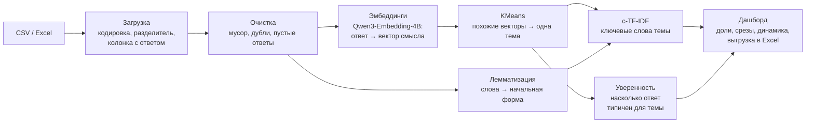

# Как всё устроено: руководство для команды

Этот документ объясняет проект целиком: что делает сервис, что происходит с данными на каждом шаге,
почему выбраны именно такие методы и чем доказано, что результату можно верить. В конце — карта
репозитория, команды и вероятные вопросы на защите с ответами.

Подробности по каждой части — в отдельных документах:
[dataset.md](dataset.md) (данные), [preprocessing.md](preprocessing.md) (очистка),
[modeling.md](modeling.md) (сравнение моделей), [evaluation.md](evaluation.md) (метрики и проверки),
[app.md](app.md) (интерфейс), [deploy.md](deploy.md) (запуск).

## 1. Задача в одном абзаце

Когда сотрудник увольняется, HR спрашивает его о причине: «Почему вы решили уйти?». Ответы — свободный
текст, их сотни, и читать всё вручную долго. Сервис принимает таблицу с ответами (CSV или Excel),
сам находит в ней **темы — повторяющиеся причины ухода**, называет их ключевыми словами и показывает,
какая причина встречается чаще, в каких отделах и когда. Заранее список причин сервис не знает:
это **тематическое моделирование** — обучение без учителя.

## 2. Путь данных: от файла до дашборда



### Шаг 1. Загрузка (`src/preprocessing/io.py`)

Реальные выгрузки бывают в разных кодировках (UTF-8, Windows-1251) и с разными разделителями
(запятая, точка с запятой). `load_table` определяет и то и другое сам. Колонку со свободным ответом
сервис угадывает как колонку с самыми длинными текстами (`guess_text_column`); её можно поменять
в интерфейсе.

### Шаг 2. Очистка (`src/preprocessing/text.py`, `pipeline.py`)

Две очистки для двух целей:

- **Лёгкая** (`normalize_text`) — для нейросети. Убираются ссылки, почта, телефоны, эмодзи, повторы
  знаков («!!!»), лишние пробелы, КАПСЛОК. Смысл и порядок слов сохраняются: нейросеть понимает
  текст целиком, ей нужна нормальная фраза.
- **Полная** (`TextPreprocessor`) — для ключевых слов. Слова приводятся к начальной форме
  (лемматизация pymorphy3: «зарплату», «зарплатой» → «зарплата»), убираются служебные слова
  («и», «что», «очень») и слова, которые есть почти в каждом ответе («работа», «компания»).
  Сленг сводится к одному слову: «зп», «з/п», «заработная плата» → «зарплата».

Кроме того, выбрасываются:
- **ответы без содержания** — «нет», «-», «не знаю», «всё нормально» (список `NON_ANSWERS`);
- **дубли строк** — двойная отправка формы. Колонки вроде `id` при сравнении игнорируются
  (их узнаём по названию), иначе дубли с разными номерами не нашлись бы.

Отчёт об очистке виден в сервисе: сколько строк отброшено и почему.

### Шаг 3. Эмбеддинги (`src/models/embedding.py`)

**Эмбеддинг** — это вектор из нескольких тысяч чисел, который нейросеть ставит в соответствие
тексту. Он устроен так, что **близкие по смыслу тексты получают близкие векторы**, даже если в них
нет общих слов. «Мало платят» и «оклад ниже рынка» окажутся рядом, а «мало платят» и «мало
задач» — далеко, хотя у них общее слово.

Близость двух векторов меряется **косинусом угла** между ними: 1 — совпадают по смыслу, около 0 —
не связаны.

Мы используем **Qwen3-Embedding-4B** (4 млрд параметров). Она понимает **инструкцию**: перед
каждым ответом ставится фраза «Identify the main reason why the employee is leaving the company».
Модель строит вектор, подчёркивающий именно причину ухода, а не стиль, длину или тон ответа.
Это дало самый большой прирост качества из всего, что мы пробовали: e5-large без инструкции —
ARI 0.22, e5-large-instruct с инструкцией — 0.42, Qwen3-4B с инструкцией — 0.68.

Векторы кэшируются на диске по каждому тексту (`models_cache/embeddings/`): повторный анализ
не пересчитывает уже известные ответы. Векторы демо-датасета лежат в репозитории
(`data/embeddings/`), поэтому демо открывается за 2 секунды без загрузки модели.

### Шаг 4. Кластеризация KMeans

Ответы — это точки в пространстве смыслов. **KMeans** делит их на заданное число групп (тем) так,
чтобы точки внутри группы были как можно ближе к её центру. Число тем по умолчанию 10; его можно
подобрать автоматически по **силуэту** — мере того, насколько ответы ближе к своей теме, чем к
соседней. Силуэт на нашем датасете предлагает 13 тем при настоящих 10: это хорошая подсказка, но
не истина, поэтому в интерфейсе есть ползунок.

Почему не HDBSCAN, который сам находит число тем? Пробовали: ARI 0.58 против 0.68 у KMeans, и часть
ответов он объявляет «выбросами». Для HR понятнее, когда каждый ответ отнесён к какой-то теме.

### Шаг 5. Ключевые слова: c-TF-IDF

Нейросеть знает, какие ответы похожи, но не говорит, *о чём* тема. Для этого все ответы темы
склеиваются в один большой документ, и в нём ищутся леммы, которые **часты в этой теме и редки в
остальных** (c-TF-IDF, как в BERTopic). Три главных слова — название темы по умолчанию:
«Зарплата, платить, деньги». Название можно поменять в интерфейсе. Две темы с одинаковым названием
объединяются.

### Шаг 6. Уверенность

Для каждого ответа считается, насколько он ближе к центру своей темы, чем к остальным (softmax по
сходствам). Ответы с уверенностью ниже 0.5 помечаются «нужно перепроверить». Метка работает:
среди уверенных ответов к правильной причине отнесены 87%, среди неуверенных — 44%.

Тонкость: у разных моделей сходства лежат в разном диапазоне (у e5 почти все в 0.80–0.90, у Qwen3
разброс вдесятеро шире). Поэтому близость меряется в единицах типичного разброса, иначе в быстром
режиме все ответы были бы «неуверенными».

### Шаг 7. Дашборд (`src/app/`)

- **Обзор** — сколько ответов, сколько тем, самая частая причина, доли всех причин.
- **Темы** — таблица тем с ключевыми словами, облако слов, самые типичные ответы.
- **Срезы** — тепловая карта «причина × отдел / стаж / формат работы» и блок «что выделяется».
  Выделяется сегмент, где причина встречается заметно чаще обычного. «Заметно» значит
  **стандартизированный остаток z ≥ 2** (как в критерии хи-квадрат) и подъём не меньше 1.3 раза.
  Так отдел из трёх человек не попадёт в выводы из-за случайности.
- **Динамика** — доля каждой причины по месяцам или кварталам.
- **Ответы** — все ответы с темой и уверенностью, фильтры, выгрузка в Excel.

Логика (`analysis.py`) отделена от интерфейса (`streamlit_app.py`): её можно проверять тестами и
вызывать из скриптов оценки — те же функции, что видит пользователь.

## 3. Данные

### Почему синтетические

Реальных экзит-интервью у нас нет. Это персональные данные, компании их не публикуют. Но
синтетика даёт то, чего нет у реальных данных: **мы знаем правильный ответ**. Каждый ответ написан
под известную причину, поэтому можно напрямую измерить, насколько темы модели совпадают с
настоящими причинами.

### Как сделан датасет (`src/generation/`, `data/synthetic_source/`)

- 10 причин ухода (`taxonomy.py`): зарплата, руководитель, карьера, переработки, график, коллектив,
  личные обстоятельства, бюрократия, условия труда, неинтересные задачи. Плюс ответы без причины.
- ~45–50 ответов на причину, написанных вручную в разном стиле: короткие и длинные, официальные и
  разговорные, с двумя причинами сразу.
- Метаданные (отдел, должность, стаж, возраст, формат работы, дата, оценка компании) генерируются
  с намеренными перекосами — **закономерностями**, которые должен найти дашборд.
  Например, IT чаще уходит из-за переработок, с марта 2025 растёт уход из-за графика (отменили
  удалёнку).
- «Грязь» как в реальных анкетах: капслок, лишние пробелы, эмодзи, дубли строк.
- Итог: 490 записей. Метки в рабочем файле скрыты: модель их не видит, они нужны только для оценки.

### Отложенный набор (`data/holdout_source/`)

199 ответов, написанных отдельно, в другом стиле (сленг, опечатки), с другими пропорциями. При
настройке они не использовались. Нужны, чтобы проверить, что мы не подогнали модель под свой
датасет (раздел 4).

## 4. Почему результату можно верить

Модель всегда выдаёт какие-то темы, даже на случайном тексте. Поэтому мы проверяем с разных
сторон — каждая проверка отвечает на свой вопрос:

| Вопрос | Проверка | Результат |
|---|---|---|
| Совпадают ли темы с настоящими причинами? | **ARI** — совпадение разбиений (0 — случайно, 1 — идеально) | **0.68** (цель > 0.5) |
| Хорошо ли найдена каждая причина? | **F1** по причинам | **0.83** в среднем, 0.75–0.91 по каждой |
| Не случайность ли это? | **Устойчивость**: 5 запусков на разных 80% данных | **0.80** (цель > 0.7) |
| Лучше ли это, чем ничего? | **Случайное разбиение** на 10 тем | ARI 0.00, F1 0.14 |
| Не подогнали ли мы под свой датасет? | **Отложенный набор** | ARI 0.59; при фиксированных темах точность **0.80** |
| Видит ли HR реальные закономерности? | 5 заложенных закономерностей | **4 из 5** |
| Понятны ли темы людям? | тест «лишнее слово», согласие разметчиков | бланк готов, ждёт заполнения |

Два важных вывода, которые стоит рассказать на защите:

1. **Связность тем (c_v) обманчива.** Это самая популярная метрика в статьях, но у LDA она
   среди лучших (0.43), а совпадение с настоящими причинами почти нулевое (ARI 0.02). На коротких
   ответах c_v измеряет частые сочетания слов, а не смысл. Поэтому модель мы выбирали по
   совпадению с эталоном, а c_v только отслеживали.
2. **Мы знаем, где модель ошибается.** Переработки и график путаются (оба про рабочее время), часть
   «пустых» ответов проходит очистку, KMeans немного меняет границы тем от запуска к запуску.
   Подробно — в [evaluation.md](evaluation.md#известные-ограничения).

### Сравнение моделей

Мы сравнили 4 семейства и 7 моделей эмбеддингов — 25 вариантов
([modeling.md](modeling.md)). Главное:

| Модель | ARI | F1 | Устойчивость |
|---|---|---|---|
| LDA (классика) | 0.02 | 0.17 | 0.02 |
| NMF (классика) | 0.10 | 0.24 | 0.35 |
| e5-large (предложена командой изначально) | 0.22 | 0.40 | 0.39 |
| e5-large-instruct | 0.42 | 0.62 | 0.51 |
| **Qwen3-Embedding-4B + KMeans** | **0.68** | **0.83** | **0.80** |

Классические модели (LDA, NMF) считают слова: «мало платят» и «оклад ниже рынка» для них не похожи.
В ответах в среднем 9 слов — слишком мало, чтобы статистика по словам сработала. Эмбеддинги
понимают смысл, и на коротких текстах это решает.

## 5. Как запускается

| Где | Когда | Как |
|---|---|---|
| **Kaggle** | показ на защите | ноутбук `sayplex/exit-interview-topics-demo` → Run All → ссылка через 5 минут |
| Свой компьютер | запасной вариант | `python -m src.app.serve` → http://localhost:8501 |
| Hugging Face Spaces | если проект пойдёт дальше | платно (PRO), всё подготовлено |

Что происходит в ноутбуке Kaggle ([deploy.md](deploy.md)):
1. проверяется видеокарта (T4, 15 ГБ);
2. скачивается проект с GitHub, ставятся зависимости;
3. `src/app/serve.py` загружает обе модели на видеокарту **до** старта сервиса и сверяет их векторы
   с эталонными (если что-то сломано, ошибка будет до показа, а не во время);
4. туннель Cloudflare даёт публичную ссылку, ноутбук сам проверяет, что она открывается.

Три режима в сервисе:
- **Точный** — Qwen3-Embedding-4B: лучшее качество, нужна видеокарта или терпение (минута на 200
  ответов на процессоре).
- **Быстрый** — e5-large-instruct: качество заметно ниже (ARI 0.42), но в 7 раз меньше.
- **Без нейросети** — NMF: работает где угодно мгновенно, но качество низкое. Нужен как запасной
  вариант и для сравнения.

## 6. Карта репозитория

```
data/
  synthetic_source/   исходные тексты ответов по причинам (основной датасет)
  holdout_source/     тексты отложенного набора
  raw/                собранный датасет: exit_interviews.xlsx (без меток), *_labeled.csv (с метками)
  holdout/            собранный отложенный набор
  embeddings/         векторы демо-датасета (демо без загрузки модели)
  human_eval/         бланк оценки людьми, ключ, папка answers/ для заполненных бланков
src/
  generation/         таксономия причин и сборка датасета
  preprocessing/      загрузка, очистка, лемматизация, стоп-слова
  models/             LDA, NMF, GSDMM, эмбеддинги + кластеризация (общий интерфейс fit/predict)
  evaluation/         метрики, сравнение моделей, проверки: закономерности, отложенный набор, люди
  app/                логика анализа, графики, интерфейс Streamlit, запуск с предзагрузкой
notebooks/
  03_topic_modeling.ipynb   ноутбук для показа 3 (модели и метрики)
  demo_kaggle.ipynb         запуск сервиса на Kaggle
docs/                 документация, результаты (results/*.csv), картинки
tests/                75 тестов (pytest)
```

## 7. Шпаргалка команд

```bash
python -m src.app.serve                              # сервис (http://localhost:8501)
```

```bash
python -m pytest -q                                  # все тесты
```

```bash
python -m src.generation.build_dataset               # пересобрать основной датасет
```

```bash
python -m src.preprocessing data/raw/exit_interviews.xlsx   # показать очистку: было → стало
```

```bash
python -m src.evaluation.model_comparison            # сравнение моделей (долго, ~20 ГБ моделей)
```

```bash
python -m src.evaluation.patterns_check              # видит ли сервис 5 закономерностей
```

```bash
python -m src.evaluation.holdout_check               # проверка на отложенном наборе
```

```bash
python -m src.evaluation.human_eval score            # результаты оценки людьми
```

## 8. Что осталось сделать команде

1. **Оценка людьми** (20–25 минут на каждого): заполнить `data/human_eval/human_eval_form.xlsx`
   по отдельности, сохранить в `data/human_eval/answers/<имя>.xlsx`. После этого результаты
   считаются одной командой, и последняя цель в таблице закрывается.
2. **Пробный показ на Kaggle**: открыть ссылку с телефона, загрузить файл (например,
   `data/holdout/exit_interviews_holdout.xlsx` — его модель ещё не видела), пройти все вкладки и
   засечь, сколько считается анализ на видеокарте: это мы пока не измеряли.
3. **Презентация и защита** — когда подойдёт время.

## 9. Вероятные вопросы на защите

**Почему данные синтетические? Это же не настоящие ответы.**
Реальные экзит-интервью — персональные данные, их нет в открытом доступе. Синтетика даёт
эталонные метки: мы точно знаем причину каждого ответа и можем честно измерить качество. На реальных
данных первым шагом нужно разметить 100–200 ответов вручную и посчитать те же метрики — код готов.

**Вы сами написали данные и сами проверили на них модель. Нет ли подгонки?**
Именно поэтому есть отложенный набор: 199 ответов в другом стиле, написанных отдельно и не
использованных при настройке. ARI на нём 0.59 против 0.64, при фиксированных темах причина угадана в
80% новых ответов. Порядок моделей (Qwen3 > e5 > NMF) тот же.

**Почему не LDA — это же классика тематического моделирования?**
Проверили: ARI 0.02 и устойчивость 0.02 — темы при каждом запуске разные. LDA нужны длинные
документы, а у нас в среднем 9 слов.

**Почему Qwen3, а не e5, которую вы планировали?**
Сравнили 7 моделей эмбеддингов. e5-large — ARI 0.22, Qwen3-4B — 0.68. Главная разница — инструкция:
модель строит вектор под нашу задачу (причина ухода), а не «вообще про смысл».

**Как сервис выбирает число тем?**
По умолчанию 10, можно подобрать автоматически по силуэтному коэффициенту — он предлагает 13. Это
подсказка, а не истина: HR может изменить число и объединить похожие темы переименованием.

**Что значит ARI 0.68? Это хорошо?**
0 — разбиение не лучше случайного, 1 — полное совпадение с настоящими причинами. 0.68 значит, что
большинство ответов распределено правильно; F1 по причинам 0.83 (из 1). Нужен ориентир: случайное
разбиение даёт 0.00, LDA — 0.02.

**Где модель ошибается?**
Путает переработки и график (оба про рабочее время): поэтому из пяти заложенных закономерностей
видны четыре. Часть «пустых» ответов («xxx», «н/д») проходит очистку. Мы это измерили и описали, а не
подогнали параметры под конкретный случай.

**Почему c_v не использовали для выбора модели?**
Проверили, коррелирует ли она с качеством: у LDA c_v одна из самых высоких (0.43), а ARI почти нулевой. На коротких
ответах c_v не отражает, правильно ли найдены причины.

**Можно ли этим пользоваться в компании?**
Метод — да, этот публичный сервис — нет: он для демонстрации. Для реальных данных тот же
Docker-образ разворачивается внутри компании, данные никуда не уходят ([deploy.md](deploy.md)).

**Сколько это стоит и как быстро работает?**
Показ идёт на бесплатной видеокарте Kaggle. Подготовка сервиса — около 5 минут (измерено на Kaggle).
На обычном компьютере точный режим считает около минуты на 200 новых ответов, быстрый — около 20
секунд. Демо-датасет посчитан заранее и открывается за 2 секунды.
