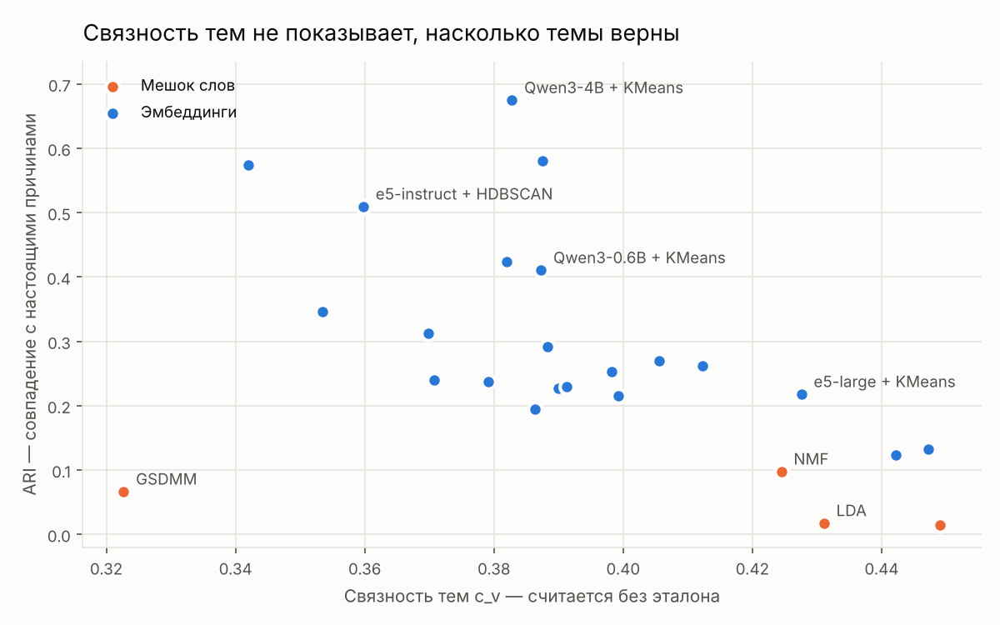

# Тематическое моделирование: модели и сравнение

Код: `src/models/`, сравнение: `src/evaluation/model_comparison.py`, ноутбук для показа 3:
`notebooks/03_topic_modeling.ipynb`. Таблицы с результатами: `docs/results/`.

```bash
python -m src.evaluation.model_comparison   # полное сравнение; модели скачаются с Hugging Face (~20 ГБ)
```

## Какие модели сравниваем

Все модели реализуют один интерфейс (`src/models/base.py`): `fit` возвращает тему каждого ответа,
ключевые слова тем с весами и уверенность модели; `predict` относит новые ответы к найденным темам.

| Модель | Как работает | На чём обучается |
|---|---|---|
| **LDA** | Вероятностная модель: документ — смесь тем, тема — распределение слов | частоты лемм |
| **NMF** | Разложение матрицы TF-IDF «документ × слово» на две неотрицательные матрицы | TF-IDF лемм |
| **GSDMM** | Модель для коротких текстов (Yin & Wang, 2014): у документа ровно одна тема, число тем находит сама | частоты лемм |
| **Эмбеддинги + кластеризация** | Нейросеть превращает ответ в вектор смысла, векторы кластеризуются (подход BERTopic) | текст после лёгкой очистки |

Модели эмбеддингов (7 штук):

| Модель | Размер | Особенность |
|---|---|---|
| `intfloat/multilingual-e5-base` | 0.3 млрд | базовая мультиязычная |
| `intfloat/multilingual-e5-large` | 0.6 млрд | предложена командой |
| `intfloat/multilingual-e5-large-instruct` | 0.6 млрд | та же e5, но понимает инструкцию |
| `deepvk/USER-bge-m3` | 0.4 млрд | дообучена для русского |
| `ai-forever/FRIDA` | 0.8 млрд | создана для русского, префикс задачи `categorize_topic` |
| `Qwen/Qwen3-Embedding-0.6B` | 0.6 млрд | на основе LLM, понимает инструкцию |
| `Qwen/Qwen3-Embedding-4B` | 4 млрд | на основе LLM, понимает инструкцию |

Модели, которые понимают инструкцию, получают перед каждым ответом:
`Instruct: Identify the main reason why the employee is leaving the company`.

Способы кластеризации: KMeans и агломеративная (число тем задаём сами), UMAP + HDBSCAN (число тем
модель находит сама).

Ключевые слова тем для эмбеддингов считаем через **c-TF-IDF**: все ответы темы склеиваем в один
документ и ищем леммы, которые часты в этой теме и редки в остальных.

## Результаты (10 тем, 459 ответов)

| Модель | Тем | ARI | Macro-F1 | c_v | Устойчивость |
|---|---|---|---|---|---|
| Случайное разбиение | 10 | 0.00 | 0.14 | — | — |
| LDA | 10 | 0.02 | 0.17 | 0.43 | 0.02 |
| GSDMM (максимум 20 тем) | 20 | 0.07 | 0.29 | 0.32 | 0.12 |
| NMF | 10 | 0.10 | 0.24 | 0.42 | 0.35 |
| e5-large + KMeans | 10 | 0.22 | 0.40 | 0.43 | 0.39 |
| USER-bge-m3 + HDBSCAN | 9 | 0.26 | 0.39 | 0.41 | 0.34 |
| FRIDA + HDBSCAN | 14 | 0.29 | 0.57 | 0.39 | 0.48 |
| Qwen3-Embedding-0.6B + KMeans | 10 | 0.41 | 0.62 | 0.39 | 0.50 |
| e5-large-instruct + KMeans | 10 | 0.42 | 0.62 | 0.38 | 0.51 |
| e5-large-instruct + UMAP + HDBSCAN | 11 | 0.51 | 0.63 | 0.36 | 0.41 |
| Qwen3-Embedding-4B + UMAP + HDBSCAN | 14 | 0.58 | 0.78 | 0.39 | 0.70 |
| **Qwen3-Embedding-4B + KMeans** | 10 | **0.68** | **0.83** | 0.38 | **0.80** |

Полная таблица со всеми 25 вариантами — `docs/results/models_k10.csv`.

## Выводы

### 1. Модели «мешка слов» не подходят для коротких ответов

После очистки в ответе в среднем 5 лемм. «Мало платят» и «низкий оклад» не имеют ни одного общего слова,
и для LDA, NMF и GSDMM это разные документы. LDA, кроме того, неустойчива: при перезапуске темы почти
полностью меняются (устойчивость 0.02). Подбор параметров (α, β) и специальная модель для коротких
текстов (GSDMM) этого не исправили.

### 2. Эмбеддинги без инструкции группируют ответы по форме

Обычная e5-large дала ARI 0.22 — вдвое лучше NMF, но далеко от цели. Разбор ошибок показал, что модель
группирует ответы частично по **форме**, а не по смыслу: короткие «плохое руководство», «плохой коллектив»,
«плохие условия» попали в одну тему, хотя причины у них разные. По той же причине мы приводим ответы,
набранные капслоком, к обычному виду: для нейросети это тоже «форма», а не смысл.

Модели, созданные специально для русского языка (USER-bge-m3, FRIDA), дали 0.23–0.29: лучше обычной e5,
но проблему не решили.

### 3. Решают инструкция и размер модели

- **Инструкция.** У `multilingual-e5-large-instruct` перед текстом можно написать, что именно важно. С
  инструкцией про причину увольнения ARI вырос **с 0.22 до 0.42** при той же кластеризации. Формулировки
  на английском и русском дают близкий результат.
- **Размер модели.** `Qwen3-Embedding` основана на большой языковой модели и тоже понимает инструкции.
  Версия на 0.6 млрд параметров работает на уровне e5-instruct (0.41), версия на 4 млрд — **0.68**.

### 4. Лучшая модель — Qwen3-Embedding-4B + KMeans

Она выполнила все три цели: ARI 0.68 (цель > 0.5), macro-F1 0.83 (цель > 0.7), устойчивость 0.80
(цель > 0.7). Каждая из 10 тем соответствует одной настоящей причине:

| Тема (ключевые слова) | Причина | F1 |
|---|---|---|
| зарплата, платить, деньги, компенсация, бонус, оклад | Низкая зарплата | 0.89 |
| здоровье, переезжать, уезжать, семья, ребёнок | Личные обстоятельства | 0.86 |
| рост, повышение, развитие, обещать, должность, обучение | Нет карьерного роста | 0.84 |
| коллектив, команда, коллега, атмосфера, отношения | Атмосфера в коллективе | 0.91 |
| процесс, согласование, система, меняться, отчёт | Бюрократия и организация | 0.81 |
| офис, график, удалёнка, час, дорога, смена | График и формат работы | 0.88 |
| руководитель, руководство, начальник, контроль | Конфликт с руководителем | 0.84 |
| задача, переработка, ночь, оставаться, норма, объём | Переработки и выгорание | 0.75 |
| задача, проект, рутина, интересный, скучно, однообразный | Неинтересные задачи | 0.77 |
| условие, плохой, оборудование, техника, склад | Условия труда и соцпакет | 0.75 |

Её цена — размер: около 8 ГБ памяти и до пары минут на 500 ответов на обычном процессоре (4 ядра).

### 5. Связность тем (c_v) нельзя использовать для выбора модели



У LDA самая высокая связность, а с реальными причинами она почти не совпадает. Связность измеряет, как часто
ключевые слова темы встречаются вместе, а не то, правильно ли разбиты ответы. Если бы мы выбирали модель
без эталонных меток, мы выбрали бы худшую. Поэтому основная метрика — совпадение с эталоном на синтетике,
а связность — дополнительный сигнал.

То же при подборе числа тем (`docs/results/n_topics.csv`): у Qwen3-4B + KMeans лучший ARI при 10 темах
(столько причин и есть), а связность максимальна при 5 темах. По связности мы выбрали бы неверное число тем.

## Какую модель используем в сервисе

- **По умолчанию: `Qwen/Qwen3-Embedding-4B` + KMeans.** HR задаёт число тем (по умолчанию 10).
- **Лёгкий режим: `multilingual-e5-large-instruct`** (~2 ГБ) — если не хватает памяти или нужен
  быстрый результат. Качество заметно ниже (ARI 0.42).

## Что ещё можно проверить

- **Giga-Embeddings-instruct** (Сбер) — по статье авторов лучшая модель на русском бенчмарке ruMTEB.
  Для запуска она выполняет код из своего репозитория; мы его просмотрели, но пока не запускали.
- **Qwen3-Embedding-8B** — ещё больше, но требует ~16 ГБ памяти.
- Проверить, что результаты сохраняются на новых данных другого стиля (спринт 5).
